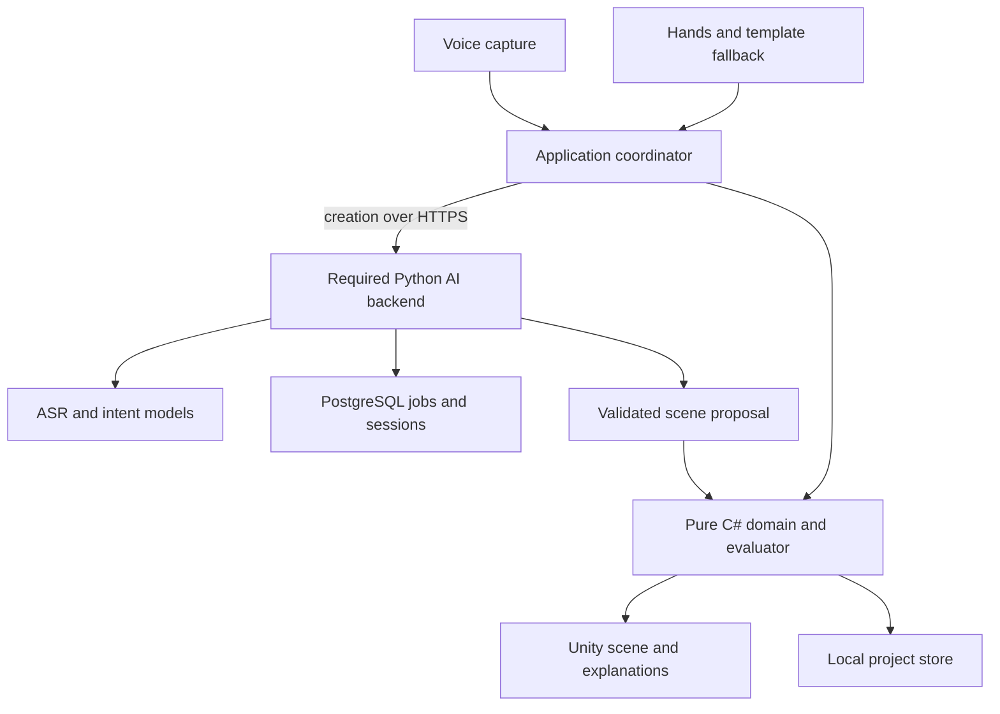

# Tryscape — Technical Specification

Version: 2.1 · Prepared: 4 November 2026 · Owner: Tryscape engineering team

Status: implementation baseline; no application implementation or device test results accompany this document.

Product: **Understand the situation. Rehearse your options. Act prepared.**

## S01. Purpose, authority, and readiness

Tryscape converts a described situation into a bounded, interactive spatial rehearsal. A user watches a task, changes supported conditions with their hands, reruns it, and understands why the result changed. The software must distinguish a generated illustration from a measured representation of a real space.

This specification is a fresh implementation reference assembled from the decisions in the project conversation. It is not a line-by-line migration of the earlier Word document, which was unavailable in the active workspace. It replaces conflicting engineering recommendations in that conversation for this implementation package; it does not claim that every proposed demo was approved.

The three delivered files have different authority:

| File | Authority |
| --- | --- |
| `docs/technical-spec.md` | Architecture, interfaces, algorithms, constraints, verification and release gates. |
| `docs/demo-scope.md` | Competition experience, scenario fixtures, user journey and acceptance requirements. |
| `CLAUDE.md` | Short working instructions for the coding agent; points to the documents above. |

Where documents disagree, resolve the disagreement explicitly before implementing affected behavior. Product scope is controlled by demo-scope; technical semantics by this specification. Record material decisions in a dated decision entry in this file until a dedicated ADR directory exists. Never silently expand scope to reconcile documents.

**Production-ready is a release outcome, not a property conferred by this document.** Code must be maintainable from its first commit. Public production claims additionally require security review, successful device validation, recovery testing, operational ownership, and the R2 gates below. A competition build can be well engineered while intentionally having fewer capabilities.

### S01.1 Release profiles

| Profile | Required behavior | What it does not imply |
| --- | --- | --- |
| R0 — competition | Required Python AI-creation backend, native hands-first rehearsal, voice creation for supported requests, local projects, explanation, replay, comparison, accessible judge build. | Universal generation, engineering certification, cloud project synchronization, commercial SLA. |
| R1 — connected private pilot | Authenticated project synchronization, expanded account data management, deployment monitoring and tested account-data backup/restore. | Open public registration or autonomous decisions in physical environments. |
| R2 — public production | R0/R1 checks plus measured reliability, documented privacy, abuse controls, accessibility review, operational runbooks and domain validation. | Support for every domain. New domains require their own validated scenario pack. |

Sections identify R1/R2 work explicitly. The creation backend and its minimum operational/security infrastructure are R0 requirements, not deferred pilot work. Accounts, cloud project synchronization and unrelated R1/R2 infrastructure remain deferred until the R0 end-to-end experience works.

### S01.2 Assumptions and unresolved deployment facts

- Four contributors, each at least twenty hours per week. Treat additional spending as zero unless the owner supplies another budget. Existing subscriptions and equipment have not been audited.
- Unity/C# is the native client; Claude Code is the development assistant. A Python 3.12/FastAPI/Pydantic 2 backend is required for the primary voice-to-scene creation pipeline. It is not the Unity gameplay runtime and is not required to manipulate or rehearse an already-created scene.
- Voice creates or configures the initial environment. All subsequent supported actions are hand operated. A hand-only creation route must also exist.
- Moving Day is the implementation default because it has a bounded, testable geometry problem. It is not represented as final user approval after the later cinematic-demo discussion. A different demo requires a scope revision and fresh acceptance fixtures.
- Hardware operating systems, exact available Quest devices, model inference capacity and hosting accounts remain unverified. M0 records them. Never mark unavailable tests as passed.
- No source repository, server, model weights or credentials are included in this document package.

## S02. Product invariants and non-goals

### S02.1 Invariants

1. A provider proposes data; the validated local application decides whether to apply it.
2. Every user-visible result identifies the exact scene revision, route and evaluator version used.
3. The same canonical scene and route produce the same constraint results on supported runtimes. Frame rate never decides success.
4. Rendering scale and XR placement cannot change model-space dimensions or conclusions.
5. No operation silently substitutes a guessed real-world measurement for a missing one.
6. Hands can complete the complete supported user journey, including error recovery and reset. Voice refusal does not trap the user.
7. A previously created scene remains usable when network services fail.
8. Unsupported requests produce clarification or a bounded unsupported response, not a fictional capability.
9. A saved comparison remains attributable after later edits; old results become visibly stale for the current scene.
10. Evaluation describes plausible results under an explicit model. It does not infer strangers' intentions or guarantee an actual delivery.

### S02.2 Explicit R0 exclusions

No foundation-model training, arbitrary mesh generation, general photogrammetry, photo/PDF reconstruction, building-code assessment, arbitrary crowd prediction, fluid/structural simulation, multiplayer, accounts, marketplace, CAD export, remote robot control or full-room walking requirement. These are optional future products, not hidden acceptance requirements. Adding one requires estimating its verification burden and removing equivalent work from R0.

R0 supports one scenario pack with a small asset catalog, rectangular floor geometry, axis-aligned rectangular blockers, one carried payload and authored route alternatives. Two mover avatars are explanatory animation. They are not a validated human biomechanics or lifting model.

## S03. Technology baseline and reproducibility

The baseline is a compatibility candidate, not an already tested combination. Meta currently documents OpenXR as the recommended Unity provider and publishes Meta XR 207 packages; its All-in-One release lists Unity 6000.0.66f2 as a minimum. Use a supported Unity 6 LTS patch that meets those constraints, rather than automatically installing the newest editor. [REF-03, REF-04]

| Component | Decision | Lock and evidence |
| --- | --- | --- |
| Client engine | Unity 6 LTS; prefer a supported 6000.3 LTS patch if the M0 sample passes. | Exact patch in `ProjectSettings/ProjectVersion.txt`; sample/build logs in M0 evidence. |
| Rendering | URP, mobile-friendly materials, initially one forward-rendered scene. | URP dependency locked with editor; profile both Quest targets. |
| XR provider | Unity OpenXR, Meta feature group for Standalone and Android. | Candidate 1.15.1 per Meta provider guidance; lock resolved compatible patch. |
| Meta interaction | Meta Core/Interaction SDK family 207.0 candidate; MRUK only where needed. | `Packages/manifest.json` and `packages-lock.json`; no mixed major SDK families. |
| Simulator | Standalone Meta XR Simulator; 207.1 candidate on supported platform. | Installation/version recorded separately from Unity packages. Do not install deprecated simulator UPM binaries. [REF-05] |
| Language | C# supported by the pinned Unity compiler; pure core compatible with Unity's supported .NET profile. | No assumption that current desktop .NET APIs work in IL2CPP. |
| Player | Android ARM64, IL2CPP, APK for distribution through release channel. | Android SDK/NDK/JDK supplied for pinned editor; dashboard requirements checked at M0 and release. [REF-06] |
| Serialization | Unity-compatible Newtonsoft.Json package, wrapped behind DTO serializers. | Resolve and lock exact package; explicit DTOs, no arbitrary polymorphic deserialization. |
| Backend ASR | Required backend transcription adapter using an approved existing provider or server-side inference such as whisper.cpp. On-device ASR is deferred. | M0 selects exact provider/model, verifies license and cost, and measures end-to-end performance; no assumed free quota. [REF-09] |
| Required AI creation service | Python 3.12, FastAPI, Pydantic 2, Uvicorn, HTTPX; pytest, Ruff, mypy. Backend ASR orchestration, model-assisted intent extraction, validation and bounded scene assembly. | `pyproject.toml`, committed `uv.lock`, `uv sync --frozen`; pinned ASR/intent-model and prompt/compiler versions. |
| Backend persistence | PostgreSQL 18 supported minor, SQLAlchemy 2 and Alembic required in R0 for jobs/sessions/idempotency. R1 adds account/project synchronization and private object storage when needed. | Image digest or managed version, migrations and recovery tests. No cloud account/project tables required in R0. PostgreSQL support policy in REF-12. |
| CI | GitHub Actions or equivalent existing runner; self-hosted Unity where licensing/resources require it. | Do not assume paid runners or Unity license entitlement. |

No React frontend, Go service, Redis cluster or Kubernetes is needed for R0. Avoid multiple serializers or competing XR input stacks. Add libraries for measured requirements, with a license entry and reviewed transitive dependencies.

### S03.1 M0 toolchain gate

Before feature work, one contributor creates the configured project, runs a hand interaction sample in the simulator, produces an ARM64 development APK and records resolved versions. A second contributor opens a clean clone and repeats the build. In parallel, the backend owner establishes FastAPI/PostgreSQL, chooses legally available ASR/intent models within the approved budget, and verifies a judge-reachable HTTPS deployment path. Record service/model versions, prompt/compiler versions, deployment limits and cost assumptions as M0 evidence. Record OS, GPU, Unity patch, SDK family, simulator version, OpenXR version, Android toolchain, device OS and model where available. Fix compatibility before four branches diverge. Do not continually upgrade dependencies during feature development.

## S04. Architecture and dependency boundaries



The domain owns model-space state and result semantics. Unity owns presentation, audio capture, input and lifecycle. The required Python backend owns ASR/model orchestration, strict intent validation and bounded scene proposals; R1 adds project synchronization. It never declares a route safe merely because a model says so. After creation, editing, evaluation, replay, comparison and local saving run on the client without server calls. Hand-created templates bypass cloud creation as a fallback, not as a substitute for the required AI feature.

### S04.1 Assembly and package ownership

| Module | Responsibilities | Must not depend on |
| --- | --- | --- |
| `Tryscape.Core` | Immutable value types, scene validation, commands, revisions, route evaluation, result evidence and hashing. | UnityEngine, network, filesystem, XR SDK, wall clock, provider SDKs. |
| `Tryscape.Application` | Use cases, service interfaces, operation state machines, cancellation and orchestration. | Vendor-specific scene objects or direct SQL. |
| `Tryscape.Unity` | View models, object presenters, asset factory, model/XR transforms, lifecycle bridge. | Model-provider authority over domain state. |
| `Tryscape.XR` | Meta input adapters, selection, hand loss and seated controls. | API keys, remote generation internals. |
| `Tryscape.Infrastructure` | JSON DTOs, atomic local persistence, bounded networking, ASR adapters and configuration. | Scene-specific success rules embedded in transport code. |
| `Tryscape.Editor` | Build entry points, validation utilities and authoring conversion. | Player inclusion; editor APIs cannot leak into runtime assemblies. |
| `services/api` | Required creation API, ASR/intent-model adapters, strict contracts, worker jobs and minimum R0 persistence; R1 adds identity/sync. | A second independent clearance evaluator. |

Core mutators are not public setters on MonoBehaviours. All committed editing goes through commands. Presentation receives immutable snapshots or read-only projections. Assembly definitions enforce dependency direction; Editor assemblies use editor-only platform constraints.

### S04.2 Proposed repository paths

These are **future implementation paths**, not existing files in this package.

| Path | Intended content |
| --- | --- |
| `app-unity/Assets/Tryscape/Core/` | Pure C# source and `Tryscape.Core.asmdef`. |
| `app-unity/Assets/Tryscape/Application/` | Coordinators and provider-neutral interfaces. |
| `app-unity/Assets/Tryscape/Unity/`, `XR/`, `Infrastructure/`, `Editor/` | Adapters and build tooling. |
| `app-unity/Assets/Tryscape/Content/` | Scenario manifests, curated prefabs and generic licensed art. |
| `app-unity/Assets/Tryscape/Tests/EditMode/`, `Tests/PlayMode/` | Behavior and lifecycle tests. |
| `contracts/` | Versioned JSON Schemas and fixtures extracted from S06–S14. |
| `services/api/` | Required R0 Python creation API/worker and minimum migrations. R1-only endpoints remain unimplemented until their gate. |
| `scripts/` | Portable checks and packaging scripts implemented in M0/M1. |
| `artifacts/` | Ignored local builds, reports and profiler evidence. |
| `docs/` | These documents; later environment, release and operations records. |

Commit Unity `.meta` files and lockfiles. Exclude `Library/`, `Temp/`, `Obj/`, logs, private recordings, keystores, credentials, caches and build outputs. Use text serialization and visible metadata. One owner edits a shared `.unity` scene at a time; feature owners prefer separate prefabs. Do not hand-edit serialized scene YAML to bypass an editor operation without understanding GUID references and validating in Unity.

## S05. Execution and feature lifecycle

### S05.1 Application states

`Booting → Ready → CapturingVoice → Transcribing → Proposing → ReviewingProposal → Editing → Evaluating → Replaying → Comparing`.

Hand-only creation goes from Ready to ReviewingProposal using a catalog template. Loading a valid saved scene goes to Editing. Error is a recoverable state with a previous stable destination; it is never a destructive scene replacement. Pause is an overlay on Editing/Replaying and a cancellation boundary during capture/generation.

At most one scene-creation operation and one evaluation are active per session. Each operation has a monotonic operation ID and cancellation token. Results carry that ID and the input revision. If the user cancels, changes scene, backgrounds the app or starts another operation, stale completions are ignored. Stopping a spinner alone does not constitute cancellation.

### S05.2 Transactional scene replacement

1. Capture a proposal without mutating the current scene.
2. Validate schema, catalog IDs, geometry bounds, routes, required assets and memory budget.
3. Present description, assumptions and dimensions for review.
4. On hand confirmation, build a staging scene root; retain the current root and state.
5. If construction succeeds, atomically switch state and active root; dispose the old root after commit.
6. If construction fails, destroy staging objects and preserve the previous project.

`SceneLoaded` and a single save are emitted after commit. No half-created scenes, orphaned native resources or partially applied AI outputs.

### S05.3 Pause, suspension and restart

Immediately stop microphone capture on focus loss. Pause replay when tracking or application focus is lost. Discard uncommitted drag previews; preserve committed edits. Inference workers must support cancellation or have their late output discarded. Persist committed project state before suspension where possible, but never rely on receiving a final lifecycle callback. On restart, recover the last valid atomic snapshot and offer to resume in Editing, never automatically resume movement or microphone access.

## S06. Canonical spatial data contract

Wire DTOs use UTF-8 JSON, `snake_case`, lowercase enum values, integers for distances and time, UUID strings for entity IDs, explicit semantic versions and UTC ISO timestamps for audit metadata. Missing and null are different. Reject duplicate JSON keys, unknown fields in major-version-1 contracts, non-finite numbers, extra-large integers, unrecognized enum values and unsafe object references. Display labels are plain text, maximum 80 Unicode characters, never interpreted as markup.

### S06.1 Units and transforms

- Domain distances are integer millimetres. Origin is the southwest floor corner. `x` points east; `z` points north. `y` is presentation height only for R0 footprints.
- Room interior is `[0,width_mm] × [0,depth_mm]`; geometry must remain inside the permitted interior at committed poses. Displayed room walls do not enlarge usable space.
- R0 object yaw is one of `0`, `90`, `180`, `270` degrees. Quarter-turn orientation swaps footprint dimensions. R0 routes contain translation-only waypoints with fixed payload yaw. Rotation during transport is R1, not silently simulated.
- One model metre equals one physical metre only in a declared true-scale view. Tabletop presentation applies a separate uniform scale; a 6 m room at 0.1 display scale is 0.6 m wide, but every calculation still uses 6000 mm.
- A single `ModelSpaceTransform` converts domain positions to the anchored presentation root. Never read a rendered world transform as authoritative model state during replay.

### S06.2 SceneSpec v1.0.0

| Field | Type / rule |
| --- | --- |
| `schema_version` | Exact `1.0.0` for initial implementation. Unsupported major rejected; migration required for other versions. |
| `scene_id`, `project_id` | UUID strings; project_id may be assigned by client before commit. |
| `scenario_pack_id`, `scenario_pack_version` | Allowlisted pack, initially `moving_day`, `1.0.0`. |
| `catalog_version` | Exact manifest version used for dimensions/colliders. |
| `revision` | Nonnegative integer, local project revision starts at 0; increments per accepted state-changing command. |
| `room` | Object containing `width_mm`, `depth_mm`; R0 range 5000–8000 each. |
| `entities` | 1–24 bounded `EntitySpec` entries with unique IDs. |
| `routes` | 1–3 named routes, each 2–12 waypoints. |
| `active_route_id` | Existing route. |
| `assumptions` | 1–16 structured records: `code`, `text`, `source`, `requires_confirmation`. |
| `provenance` | `illustrative` or `user_measured`; R0 starts illustrative. Measurement claims require per-field source records. |
| `measurement_sources` | List of `{field_path, source, confirmed_at}`; source `user_confirmed` only in R0. No model-invented confirmations. |

### S06.3 EntitySpec and route records

`EntitySpec` fields: `id`, `catalog_id`, `role` (`payload`, `blocker`, `decoration`), `pose` (`x_mm`, `z_mm`, `yaw_deg`), `editable`, `label`. Dimensions and collision participation come from the catalog. A proposal cannot override prefab paths, material shaders, arbitrary dimensions or executable types. Room walls and door markings are generated from the room/template manifest, not arbitrary imported meshes.

`RouteSpec` fields: `id`, `label`, `payload_entity_id`, `speed_mm_per_s`, `waypoints`. Each waypoint is `{x_mm,z_mm}`. Speed is 100–500 mm/s, default 250, and is illustrative animation speed rather than a measured labor-duration estimate. Every consecutive segment must be nonzero and parallel to x or z. Start must equal the payload's committed start pose; all route alternatives end at the same destination. No duplicate IDs or cyclic reference graphs. Collinear redundant points may be normalized once before hashing; record normalized data, not different hidden behavior across runtimes.

All required fields and invariants become JSON Schema plus semantic validators in M1. JSON Schema checks shape; it does not replace collision, route or catalog validation.

### S06.4 Minimal normative scene fixture

The following is valid application data after the pack/catalog exists. UUIDs here are fixture IDs; they do not identify real users. No content hash is asserted before canonical serialization is implemented.

```json
{
  "schema_version": "1.0.0",
  "scene_id": "10000000-0000-4000-8000-000000000001",
  "project_id": "20000000-0000-4000-8000-000000000001",
  "scenario_pack_id": "moving_day",
  "scenario_pack_version": "1.0.0",
  "catalog_version": "1.0.0",
  "revision": 0,
  "room": {"width_mm": 6000, "depth_mm": 5000},
  "entities": [
    {
      "id": "30000000-0000-4000-8000-000000000001",
      "catalog_id": "sofa_standard",
      "role": "payload",
      "pose": {"x_mm": 1000, "z_mm": 2500, "yaw_deg": 0},
      "editable": false,
      "label": "Delivery sofa"
    },
    {
      "id": "30000000-0000-4000-8000-000000000002",
      "catalog_id": "console_standard",
      "role": "blocker",
      "pose": {"x_mm": 2500, "z_mm": 2500, "yaw_deg": 0},
      "editable": true,
      "label": "Console table"
    }
  ],
  "routes": [
    {
      "id": "direct",
      "label": "Direct approach",
      "payload_entity_id": "30000000-0000-4000-8000-000000000001",
      "speed_mm_per_s": 250,
      "waypoints": [
        {"x_mm": 1000, "z_mm": 2500},
        {"x_mm": 4000, "z_mm": 2500},
        {"x_mm": 4000, "z_mm": 3800}
      ]
    },
    {
      "id": "north_detour",
      "label": "Northern approach",
      "payload_entity_id": "30000000-0000-4000-8000-000000000001",
      "speed_mm_per_s": 250,
      "waypoints": [
        {"x_mm": 1000, "z_mm": 2500},
        {"x_mm": 1000, "z_mm": 4000},
        {"x_mm": 4000, "z_mm": 4000},
        {"x_mm": 4000, "z_mm": 3800}
      ]
    }
  ],
  "active_route_id": "direct",
  "assumptions": [
    {
      "code": "illustrative_layout",
      "text": "Prepared example; dimensions are not measurements of your home.",
      "source": "template",
      "requires_confirmation": false
    },
    {
      "code": "upright_fixed_orientation",
      "text": "The sofa remains upright at a fixed orientation; lifting and turning are not assessed.",
      "source": "scenario_model",
      "requires_confirmation": false
    }
  ],
  "provenance": "illustrative",
  "measurement_sources": []
}
```

### S06.5 Catalog manifest

Each entry defines `catalog_id`, footprint width/depth in mm, rendered height, collision participation, allowed roles, prefab reference resolved locally, editable pose constraints, asset license ID and catalog version. Initial normative entries:

| ID | Footprint x × z | Rendered height | Semantics |
| --- | --- | --- | --- |
| `sofa_standard` | 1800 × 800 mm | 900 mm | One payload; fixed yaw 0 in the reference fixture. |
| `console_standard` | 600 × 1000 mm | 800 mm | Editable floor blocker; all of its footprint obstructs transport. |

Collision proxies must visibly match the represented footprint. An apparent table opening does not imply the sofa can pass underneath. In R0, every blocker is a floor obstruction independent of height; disclose this and avoid art suggesting unsupported clearance. Generic movers attach to the playback rig and are omitted from the geometric clearance guarantee.

## S07. Commands, revisions and edit semantics

### S07.1 Command envelope

Fields: `command_id` (UUID), `project_id`, `expected_revision` (integer), `type` (allowlisted), `payload` (typed object). Timestamps are optional audit data and never determine command ordering. Local coordinator accepts commands sequentially on the application thread. It returns `{command_id, accepted, revision, error_code, changed_entity_ids}`. A rejection leaves state untouched.

| Command | Payload | Rule |
| --- | --- | --- |
| `move_entity` | `entity_id`, `x_mm`, `z_mm` | Editable blockers only; 50 mm snapping; valid floor placement; cannot overlap payload start or another blocker. |
| `rotate_entity` | `entity_id`, `yaw_deg` | Editable blocker; quarter turns only; same placement checks. |
| `select_route` | `route_id` | Route must exist in pack; does not mutate its waypoints. |
| `undo` / `redo` | Empty | Reapply a stored before/after domain change as a new revision. Never decrement revision. |
| `reset_scene` | Empty | Restore confirmed creation snapshot; increment revision once and clear undo/redo. Preserve saved runs. |
| `replace_scene` | Validated SceneSpec | Transaction described in S05; fresh scene identity; never an arbitrary model command. |

R0 does not expose freeform route drawing or payload rotation in transit. Such actions require additional contracts and geometry tests. Clear UI feedback is preferable to an apparently interactive control that does nothing meaningful.

### S07.2 Drag transaction and input arbitration

During dragging, move only a visual preview. Display floor projection, snap indicator and invalid-placement feedback. On release, convert the proposed model pose to snapped integers and submit one command. On invalid placement, return to last committed position and explain the restriction without losing the scene.

One hand owns a drag. A second hand cannot concurrently commit another move. If tracking is lost for 200 ms, freeze the preview; after 1000 ms cancel the drag. These are initial tuning targets and must be checked with real users. Reacquisition never commits automatically. Hand capture does not leak into UI behind the selected object. Pointer rays and direct interactions have explicit priority rules.

Editing pauses or exits playback before changing the canonical state. Each accepted state change invalidates the current live result; old saved runs remain viewable with their scene revision. Undo is limited to the last 50 accepted edit changes; starting a new edit after undo clears redo. Repeated delivery of the same command ID within the coordinator's 256-entry bounded cache returns the original response without another mutation; persistence must not replay acknowledged commands blindly after restart.

## S08. Spatial evaluator and simulation model

### S08.1 Authority and scope

The R0 evaluator is a deterministic 2D footprint/path checker. It answers: **does this fixed-orientation payload footprint, including the declared model margin, intersect any represented blocker or leave the represented room along this route?** It does not answer whether real movers can lift, pivot, balance or carry a sofa, whether a doorway's height suffices, or whether an unrepresented obstacle exists.

The initial model margin is 25 mm on every payload side. It is an illustrative model parameter, not a real-world safety recommendation. Outcomes use `clear_in_model`, `blocked_in_model`, `invalid_input` or `unsupported`; never a blanket `safe` label. A clear result may say: "No modelled floor obstruction on this route. Height, turning and lifting were not assessed."

### S08.2 Exact translation checks

For fixed quarter-turn yaw, the payload footprint is an axis-aligned rectangle. Represent blocker extents as integer bounds. Inflate each blocker by payload half-extents plus margin, then intersect the payload center's continuous line segment with that closed rectangle. This Minkowski expansion handles the entire path segment, not just sampled frames. Contact at the margin boundary counts as blocked.

Avoid half-millimetre ambiguity by expressing internal coordinates in doubled millimetres: center `C2 = 2*C`, payload half-extent becomes its full dimension in doubled coordinates, and margin `M2 = 2*M`. All source dimensions remain integer millimetres. Use checked 64-bit intermediate arithmetic. Axis-aligned segment intersections can produce exact rational entry positions; compare numerator/denominator pairs through bounded checked products or a rational helper. Never let platform float rounding choose which obstacle was hit first.

Room containment uses the room shrunk by payload half-extents plus margin. The entire center segment must remain in the closed permitted rectangle; touching the room boundary at exactly the allowed margin is accepted, while contact with an inflated blocker boundary is blocked. Document this intentional distinction: wall containment provides at least the margin, whereas obstacle tangency is treated conservatively. Tests cover both boundaries. Invalid initial overlap prevents evaluation and editing must resolve it first.

For each route segment, evaluate room bounds and all collision-participating blockers. Select the earliest violation by segment index, exact path fraction, then blocker ID ordinal as tie-breaker. The first violation terminates playback before contact. Do not report a later obstruction as the reason for stopping. Preserve all metadata needed to reproduce that choice.

### S08.3 Timing and playback

Evaluation is independent of render frames. Route length is the sum of axis-aligned distances. Playback uses a 20 Hz logical timeline with display interpolation; route progress is derived from elapsed logical time and the illustrative speed. Use integer/rational arithmetic for the stop location and timeline boundary; presentation may use floats after the result is fixed. On a blocked route, clamp the visible payload just before the modelled contact and highlight the actual contact region.

Seeking or replaying a run recomputes presentation from route progress; it does not resimulate Unity rigidbody history. No accumulated `transform += velocity * deltaTime` drift. The core evaluator can finish before playback begins. Mover animations follow the payload rig; they cannot change the result. A short "illustrative playback speed" label prevents users treating seconds as a real delivery-time prediction.

### S08.4 Future model extensions

Payload turning, arbitrary polygons, swept 3D volumes, doorway heights and actor clearance are separately versioned evaluator capabilities. R1 rotation may use a conservative bounding envelope, but any rejection caused only by that envelope must be labelled conservative rather than a proven physical collision. Do not upgrade the displayed promise without validating the new algorithm and adding challenging fixtures. A route that is clear under v1 can legitimately change under v2; retain both evaluator versions with old runs.

## S09. Results, explanations and comparison

`EvaluationResult` contains `schema_version`, `run_id`, `scene_id`, `scene_revision`, `scene_hash`, `route_id`, `catalog_version`, `evaluator_version`, `outcome`, `route_length_mm`, `first_violation` (nullable), `assumptions`, and `created_at`. `created_at` is metadata outside the deterministic result hash.

`first_violation` contains `rule_code`, `entity_ids`, `segment_index`, `entry_fraction` (`numerator`, positive `denominator`), `contact_center` (rational x/z), `model_margin_mm`, and `message_key`. Evidence, not LLM prose, selects an explanation template. Initial rule codes: `blocker_intersection`, `room_boundary`, `invalid_start`, `unsupported_orientation`, `invalid_route`.

Separate the deterministic `EvaluationEvidence` projection from its run envelope: the projection includes input hash/versions, route, outcome, route length, violation and model assumptions, but excludes `run_id`, audit timestamps and presentation progress. Hash and byte-compare this projection for reproducibility. Two distinct runs can have different envelope IDs/times while their evidence is identical. Invalid-input results reference the rejected input's validation errors rather than pretending it acquired a valid scene hash.

An explanation has three layers: the observed event, the modelled reason with spatial highlight, and a supported action the user can try. Suggestions are constrained commands such as moving the named blocker or selecting an existing alternative route. An AI can rephrase an explanation only if optional, evidence-grounded and clearly subordinate; R0 uses authored templates.

Comparison stores two complete immutable run snapshots. Show outcome, route length, scene changes and assumptions. Do not compare a clear result to an invalid scene as though both were viable alternatives. Do not invent money saved, accident risk reduction, success probability or time saved. Computed route length is valid; modeled playback seconds must remain explicitly illustrative.

### S09.1 Canonicalization and identity

Define `scene_hash = SHA-256(canonical UTF-8 scene bytes)` after validation. A restricted canonical serializer sorts object keys ordinally, preserves semantically ordered arrays, sorts entity arrays by ID and route arrays by route ID, emits integers in base 10 without leading zeros, normalizes user labels to NFC and emits deterministic JSON escaping. No whitespace or optional audit timestamps enter the canonical bytes. Unknown optional fields cannot silently change the hash contract. Store serializer version with saved runs. Test serialization bytes and hashes on Editor and IL2CPP; do not claim RFC 8785 compliance without implementing its exact rules.

The scene hash includes the selected route and revision. Result identity additionally includes evaluator and catalog version. Hashes provide reproducibility and corruption detection, not cryptographic trust in client claims. R1 synchronized results remain client-derived until a trusted implementation of the same evaluator independently validates them.

## S10. Voice, intent and generation

### S10.1 Required product journey

User chooses Speak, grants microphone permission if needed, records at most 15 seconds, stops, sees the transcript and proposed scene summary, then confirms with hands. From that point, hand controls operate the rehearsal. A hand-selectable template and parameter editor provide the same supported scene-creation capabilities without microphone access.

Voice creation is an R0 product acceptance requirement; the hand fallback does not falsely count as passing the voice feature. It does preserve a usable competition experience if speech is unavailable. If voice cannot meet its device/reliability gate, the owner must explicitly change the release scope before claiming it complete.

### S10.2 Required backend pipeline and client adapters

`ITranscriptionProvider.TranscribeAsync(AudioClipData, cancellation)` returns text, provider ID, locale, elapsed time and optional provider confidence. `ISceneProposalProvider.ProposeAsync(transcript, supportedCatalog, cancellation)` returns a typed `SceneProposal`. In R0, both are client-side HTTP adapters to the required backend job endpoints in S13. Neither can invoke scene methods or return executable code.

The primary creation sequence is: Unity records bounded audio → backend transcription job → transcript review → backend scene-proposal job → model-assisted intent extraction → strict Pydantic/catalog validation → deterministic bounded SceneSpec assembly → Unity revalidation and hand confirmation → local scene instantiation. Models interpret the request; approved assets and schema-driven assembly make its spatial representation controllable. The local evaluator remains authoritative for rehearsal outcomes.

The backend may call an approved external ASR/intent model or run inference on provisioned server compute. Model hosting is independent of the mandatory API boundary. M0 records exact model/provider versions, licensing, expected volume, quotas, latency, availability and cost. A local workstation is developer-only; the release pipeline must be reachable without it. Free hosting/model quotas are not assumed. If no viable deployment exists within approved spending, the primary creation pipeline is blocked; a working local fallback does not satisfy it.

Do not quietly replace model-assisted creation with a keyword-only local parser. Deterministic preflight clarification and template assembly remain valid supporting steps. On-device ASR/intent inference may be investigated in a later architecture revision, but is not an alternate R0 baseline. Backend ASR can use a reviewed server-side runtime such as whisper.cpp; no Android native-ASR plugin is required. [REF-09]

### S10.3 SceneProposal v1.0.0

Fields: `schema_version`, `proposal_id`, `status` (`ready`, `needs_clarification`, `unsupported`), `transcript`, `intent`, `scene` (SceneSpec or null), `questions`, `assumptions`, `provider_metadata`.

`intent` is an allowlisted record, nullable only while status is `needs_clarification` or `unsupported`: `scenario_pack_id`, `room_width_mm`, `room_depth_mm`, `payload_catalog_id`, `obstruction_state` (`center`, `parked_south`), `preferred_route_id`. A `ready` proposal requires a complete non-null intent. Numeric speech may specify metres or centimetres; normalization converts once to mm and returns the interpreted value for review. R0 accepts supported rectangular dimensions and catalog choices only. A request for floor plans, arbitrary scans or human behavior prediction produces a clear unsupported response.

`questions` has at most three entries with `field`, `prompt`, and 2–4 hand-selectable choices. For missing dimensions the user may choose the example defaults, but this sets provenance to illustrative. The provider cannot mark measurements confirmed. A `ready` proposal must have a non-null validated scene and no unresolved required question. A `needs_clarification` response must not replace current state.

The parser/template assembler must actually use the supported spoken parameters: two requests with different supported room widths must produce distinct validated layouts. A single hardcoded scene returned for every prompt does not pass generation acceptance. Rebuild the enclosing room deterministically and validate routes/object positions before review. For Moving Day pack 1.0.0, the fixed internal coordinates in demo-scope D06 remain unchanged across the supported 5–8 m room range; walls, room bounds and dimension labels change. This is constrained scene assembly, not a claim of newly optimized routes.

### S10.4 Input/output protections

Transcripts are untrusted content, maximum 2000 characters. A model system prompt specifies only schema generation, supported capabilities and no actions. Prompt injection text is treated as user scene text; model output is still parsed through strict field/catalog limits. No shell, SQL, Unity code, remote asset fetch or arbitrary file path is derived from output. Raw provider errors do not appear in headset UI. A malformed response is retried at most once for schema repair, within the same operation deadline, then offers hand creation. A cancellation or scene revision change prevents application of repaired output.

### S10.5 Voice acceptance and privacy

Initial targets, not measured facts: at least 18 of 20 supported quiet-room utterances produce the correct scenario parameters after at most one confirmation; median end-of-recording to review under 8 s, p95 under 15 s across the deployed backend path, excluding deliberate user review time. Capture and networking must not freeze rendering. Test microphone refusal, silence, background speech, accent variation, permission revocation, cancellation and backend/model outage. Local raw audio is memory-only by default and released after transcription; backend audio follows S13 temporary-deletion limits. Explain remote audio/transcript processing and obtain purpose-specific consent before upload. Exporting recordings for debugging requires explicit opt-in and is off in the release build.

## S11. Native user experience and XR integration

Default is a seated tabletop view. Keep the room within a reachable uniform scale; provide hand-selectable zoom, recenter and orientation controls rather than requiring leaning or walking. A room transform is presentation state and is saved separately from model geometry. Use a comfortable panel position, legible text, visible selection and non-color-only status feedback. Testing determines actual sizes and placement rather than declaring accessibility from a document.

Use Meta Interaction SDK adapters for direct grab and ray selection. Runtime input is translated to application intents rather than referencing domain entities through Unity instance IDs. Provide a consistent selected-state outline, floor shadow and release target. Prefer one-hand interactions in R0. Optional two-hand scaling may transform the tabletop root only and must never resize the modelled sofa or room.

If passthrough is enabled, anchor the tabletop to a detected or explicitly placed surface where supported and validate behavior in multiple real rooms. Failure to obtain room data must offer manual tabletop placement or a neutral VR environment. Passthrough must not be a required room scan when voice has created an illustrative scene. Actual-room reconstruction and its measurement uncertainty are outside R0.

Settings, pause, help, reload and recovery controls must work with hands. Provide hand-selectable microphone controls and typed/choice-based dimension editing. Do not assume speech, controllers, a phone, a laptop or a third-party accessory is available during judging. Full-scale viewing is optional future presentation work; it must not become a completion requirement or imply new physical accuracy.

Permissions are requested only when entering the relevant feature. Microphone denial retains the rest of the app. Room/anchor permissions are requested only for actual MR placement features. No camera image capture is required for the synthetic voice-created scene. Labels distinguish `Example environment`, `User-confirmed dimensions`, and `Not assessed` visibly at review and results.

## S12. Local persistence and recovery

R0 uses bounded versioned JSON snapshots in `Application.persistentDataPath`. Directory layout is `projects/<uuid>/project.json`, `runs/<uuid>.json`, and an application-owned index. File names are derived from validated UUIDs, never display names. Use a small local index file rather than SQLite/native plugins unless measured needs justify them.

`ProjectSnapshot` stores schema version, project identity, created/updated timestamps, confirmed creation scene, current scene, presentation settings, saved comparison IDs and last successful serializer version. `RunSnapshot` stores the evaluated scene, route and immutable result. No recording, provider secret or access token is embedded in these files.

Write to a sibling temporary file, flush and close, verify parse/hash, then use a platform-validated atomic replace strategy with one previous snapshot backup. Do not claim POSIX rename semantics automatically apply to every Unity Android API. The implementation must test interruption before/after each write stage. On load: validate size, JSON shape, schema and hash; if invalid try backup; otherwise show a recoverable error and offer the bundled sample. Never overwrite a corrupt file before preserving diagnostic metadata or user-selected export.

Initial limits: 20 projects, 20 saved runs per project, 1 MiB maximum per JSON snapshot, 100 MiB total local project storage. Enforce quotas with clear UI; do not silently delete user projects to save a new one. Logs use a separate small rolling budget. Delete project removes its snapshots and index entry; retained backup behavior must honor deletion. Exports are optional R1 and require redaction controls.

Schema upgrades are explicit functions with fixtures. Unknown newer major versions remain read-protected and are not rewritten. Keep original bytes until a migrated copy passes validation. Test migration twice to verify idempotence and preserve prior run attribution. Device uninstall can remove local data; disclose this in pilot onboarding before users rely on persistence.

## S13. Required AI creation backend and API contract

Implement the creation API and worker in R0. PostgreSQL stores minimum durable job, anonymous-session and idempotency records, separate from deferred cloud account/project storage. Existing local scenes and the hand-selectable template fallback require neither server nor database at runtime. Public deployment is never accomplished by pointing an APK at a developer's `localhost`: on Quest that address identifies the headset itself. A development LAN address is allowed in a debug configuration; release configurations accept allowlisted HTTPS origins only.

Use FastAPI routes with strict Pydantic DTOs (`extra='forbid'`, bounded integers/strings, explicit unions). Use lifespan-managed provider clients and connection pools. Native model inference and slow work run in a bounded worker process; they do not block the ASGI request event loop. A separate worker is required for durable jobs. Do not present FastAPI in-process background tasks as a durable queue. [REF-10, REF-11]

### S13.1 Common transport semantics

- Base API version `/v1`. Breaking shape/meaning changes require a new major route and migration plan.
- JSON request body limit 16 KiB for proposal jobs; scene/project uploads 1 MiB; API output limit 1 MiB. Reject before expensive parsing. Audio has the separate limit below.
- `X-Request-ID` is a validated UUID or server-generated; echo it. Logs contain request ID, duration, status and code, not raw request bodies.
- Creation job requests include `X-Processing-Consent-Version`, a bounded 64-character identifier of the notice accepted in the headset. The backend requires a currently accepted notice version before receiving audio or sending transcript content to a model, and records session, purpose, version and timestamp in minimal consent records. This header records the client affirmation; it is not evidence of identity and cannot bypass authorization or usage limits.
- Mutating job creation requires an `Idempotency-Key` UUID. Scope uniqueness to authenticated owner or anonymous session, method and normalized route. Store request hash and response identity. Same key/same request returns existing job; same key/different body returns 409.
- Client connection timeout 3 s; overall proposal job deadline 30 s including provider retries. Poll every 1 s initially, then 2 s with jitter; stop on cancellation, deadline or terminal state. Retry read-only polls at most twice within the same deadline. Never create a new job merely because a create response was lost; reuse its idempotency key.
- Gateways terminate HTTPS, enforce body/connection limits and forward only trusted proxy headers. No disabled certificate checks in release. CORS is restricted for any future web client; CORS is not authentication for a native app. [REF-10]
- Do not expose provider credentials, arbitrary stack traces, private host names or prompts in errors.

### S13.2 Endpoints and release ownership

| Method / route | Profile | Request | Success and key behavior |
| --- | --- | --- | --- |
| `GET /health/live` | Any deployed service | None | 200 process live; no database/provider calls or sensitive config. |
| `GET /health/ready` | Any deployed service | None | 200 able to accept configured work; 503 if required database/queue unavailable. External provider outage is separately reported in metrics; do not endlessly restart a healthy process. |
| `POST /v1/anonymous-sessions` | Required R0 | Empty JSON object; rate-limited at edge | 201 short-lived opaque session token; no account needed for core demo. |
| `POST /v1/scene-proposal-jobs` | Required R0 | `schema_version`, `transcript`, `locale`, `scenario_pack_id`, `catalog_version` | 202 `{job_id,status,poll_after_ms}`; validate capability before enqueue. |
| `POST /v1/transcription-jobs` | Required R0 | Raw supported WAV body; `Content-Type: audio/wav`, locale header | 202 job receipt; request permission/consent before upload. No remote URL input. |
| `GET /v1/jobs/{job_id}` | Service | Owner-scoped ID | 200 bounded state/result; unauthorized or absent ID returns 404. |
| `DELETE /v1/jobs/{job_id}` | Service | None | 202 cancellation requested, or 204 if already terminal/cancelled; repeat is safe. |
| `POST /v1/projects` | R1 | Initial ProjectSnapshot | 201 metadata plus ETag; enforce per-owner quota. |
| `GET /v1/projects?cursor=...&limit=...` | R1 | Opaque cursor, default 20/max 50 | Owner-scoped metadata page; never return another owner's project. |
| `GET /v1/projects/{id}` | R1 | None | 200 snapshot and ETag, max 1 MiB. |
| `PUT /v1/projects/{id}` | R1 | Snapshot plus mandatory `If-Match` | 200 new ETag; 412 on stale revision, no overwrite. |
| `DELETE /v1/projects/{id}` | R1 | `If-Match` | 204 deletion/tombstone; schedule associated object deletion. |
| `POST /v1/projects/{id}/runs` | R1 | Client RunSnapshot | 201 marked `client_derived`; validate shape, ownership and size, never claim server validation. |
| `POST /v1/account/deletion-requests` | R2 | Authenticated confirmation token | 202 tracked deletion request; operationally complete within stated retention policy. |

Any endpoint referenced by the shipping client must exist and be contract-tested. Deferred routes are omitted from the R0 client and are not implemented as misleading 200 stubs. Health, anonymous-session, transcription/proposal creation, polling and cancellation are required R0 routes and must be deployed for release. Account/project-sync endpoints remain R1.

For accountless hosted creation, issue a cryptographically random 256-bit session token from the anonymous-session endpoint, store only its hash with a 1-hour expiry, and send it through the Authorization Bearer header on job operations. Return the raw token only at creation and retain it only in client memory. Scope job lookup/cancellation and idempotency keys to that session. This prevents simple cross-session job access; it does not make an anonymous public client trusted. Apply IP/global limits to session issuance as well as job creation so minting new sessions does not bypass spending controls. For R1, OIDC access tokens supply the owner scope. Never return job results based solely on possession of a job UUID. Expired sessions can still use local rehearsal and create a new session; old private job results are not reassigned to it.

Example proposal request:

```json
{
  "schema_version": "1.0.0",
  "transcript": "Prepare a six by five metre living room for a sofa delivery",
  "locale": "en",
  "scenario_pack_id": "moving_day",
  "catalog_version": "1.0.0"
}
```

Example completed job response:

```json
{
  "job_id": "40000000-0000-4000-8000-000000000001",
  "status": "succeeded",
  "kind": "scene_proposal",
  "result_schema_version": "1.0.0",
  "result": {
    "schema_version": "1.0.0",
    "proposal_id": "50000000-0000-4000-8000-000000000001",
    "status": "needs_clarification",
    "transcript": "Prepare my room for a delivery",
    "intent": null,
    "scene": null,
    "questions": [
      {
        "field": "room_dimensions",
        "prompt": "Use an example room or enter dimensions?",
        "choices": ["Use 6 m by 5 m example", "Enter dimensions"]
      }
    ],
    "assumptions": [],
    "provider_metadata": {"provider_id": "backend_orchestrator", "version": "1.0.0"}
  },
  "error": null
}
```

A successful job can legitimately return a proposal needing clarification: backend orchestration succeeded, but scene creation has not been confirmed. Preflight may request missing values before an intent-model call; the supported voice-to-ready-scene acceptance journey must still exercise actual model-assisted interpretation. A transcription job's successful result is `{text,locale,provider_id}` rather than SceneProposal. `kind` discriminates results; clients reject mismatched kinds.

Provider metadata identifies the public orchestration deployment version. Backend processing evidence must also identify actual ASR/intent-model versions, prompt version and scene-compiler version, without exposing credentials or retaining private prompts in routine logs. Freeze those versions for submission. An orchestration label alone is not evidence that a model ran.

The client enforces one 30-second active-processing budget across transcription, transfer, polling and scene proposal, excluding deliberate user-review time. Cancellation/deadlines carry across phases; starting the second job does not reset this budget. Each server job has its own maximum 30-second deadline and the client still cancels when its remaining overall budget expires. Measure this complete path, not one fast endpoint in isolation.

### S13.3 Errors and limits

Error envelope is `{error:{code,message,request_id,retryable,details}}`, with `details` containing only safe field/code pairs. Required codes: `invalid_request` (400), `unauthenticated` (401), `not_found` (404), `idempotency_conflict` (409), `revision_conflict` (412), `payload_too_large` (413), `unsupported_media` (415), `validation_failed` (422), `rate_limited` (429), `provider_unavailable` (503), `deadline_exceeded` (504), `internal_error` (500). A 429 includes bounded `Retry-After`; UI can offer local creation rather than force a retry.

Initial hosted-service limits: 4 creation jobs/minute/session, 20/hour/IP plus operator-configured daily model budget. A session or IP address is not a trustworthy identity; combine edge enforcement, global queue limits and kill switch. Do not claim anonymous rate limits prevent all abuse. At most one active generation and one active ASR job per session; worker concurrency initially 1 for a single model process. Reject overflow with 429/503, not an unbounded memory queue.

For audio, accept PCM WAV only: mono, 16 kHz, 16-bit, 15 s maximum, 512 KiB maximum including bounded headers. Validate actual decoded frame count and WAV fields; neither extension nor Content-Length alone is sufficient. No shell-based media conversion, compressed formats or arbitrary URL ingestion in R0. Clean temporary bytes after success, cancellation or expiration, with a maximum 15-minute cleanup deadline for failed jobs. Set no-store on transcript/audio responses. In the initial single-host deployment, API and worker may share an access-restricted temporary volume with random application-owned file names; only opaque references enter the job store. No raw audio enters routine logs or database backups. If a process/host failure loses an input, mark the job failed and offer a new recording rather than leaving it running indefinitely. Multi-host deployment requires a reviewed private input store and explicit deletion reconciliation before it is enabled.

### S13.4 Job state and worker leases

Job states are `queued`, `running`, `succeeded`, `failed`, `cancel_requested`, `cancelled`, `expired`. Jobs have owner/session scope, immutable input hash, request deadline, lease owner, lease expiration and attempt count. A PostgreSQL worker can claim a queued row transactionally with `FOR UPDATE SKIP LOCKED`; commit the claim before inference. Heartbeat at a bounded interval; after lease expiration, retry only if the deadline and attempt policy permit. This is at-least-once execution: completion writes are conditional and idempotent.

Provider timeout or 5xx permits one retry with jitter if deadline permits. Invalid request, invalid catalog and permission errors do not retry. A late completion cannot overwrite cancelled/expired terminal state. Cancellation is best effort at provider level, but clients and server must discard late output. Idempotency records live 24 h; job results expire after 24 h by default; plaintext transcripts are purged with result expiration. No silent retention extension for analytics.

## S14. Backend persistence, R1 identity and synchronization

### S14.1 Identity

R0 core rehearsal is accountless. R1 sync uses an existing OIDC provider with Authorization Code + PKCE appropriate to the native app. Do not build password storage. Verify issuer, audience, signature, expiration and allowed algorithms against pinned provider configuration; refresh signing keys safely. Store refresh credentials through a platform-secure storage adapter backed by Android Keystore or the identity SDK's reviewed equivalent, not JSON preferences. Keep access tokens in memory and minimize lifetime.

Optional sync enrollment must not block the complete hand-only R0 experience. If browser-based enrollment is awkward on headset, defer sync rather than claiming an inaccessible login is acceptable. A public client ID is not a secret. Never ship provider API keys or a shared backend administrator token in the APK.

### S14.2 Persistence schema

R0 requires `jobs`, `anonymous_sessions`, `idempotency_records` and minimal consent/audit records. R1 adds `users`, `projects`, `project_versions`, `runs` and file metadata when those features ship. Jobs have either an authenticated owner or anonymous-session scope, enforced by a database constraint. R0 migrations must not require deferred account/project tables: add authenticated-owner relationships in the R1 expand migration. Use UTC `timestamptz`, UUID keys, bounded JSONB payloads and explicit schema versions. Every scoped query filters by authenticated owner or validated anonymous session; possession of a UUID is not authorization.

| Table | Key fields and invariants | Index / deletion |
| --- | --- | --- |
| `users` | `id`, unique `(issuer,subject)`, created_at, deletion_state. Store email only if necessary. | Unique identity index; deletion cascades application data after retention obligations. |
| `projects` | `id`, `owner_id`, title, server_revision bigint, schema_version, snapshot jsonb, snapshot_hash, created_at, updated_at, deleted_at. | `(owner_id,updated_at,id)` pagination; FK owner; revisions compare atomically. |
| `project_versions` | `id`, `project_id`, owner_id, server_revision, snapshot/hash, created_at. Unique `(project_id,server_revision)`. | Retain last 20 or 30 days, whichever smaller, unless policy specifies otherwise. |
| `runs` | `id`, project_id, owner_id, scene_hash, scene_revision, evaluator_version, catalog_version, result jsonb, trust_level=`client_derived`. | `(project_id,created_at,id)`; project delete cascades/tombstones. |
| `jobs` | `id`, owner/session scope, kind, status, request_hash, input/result references, deadline, lease, attempts, error_code, timestamps. | `(status,lease_expires_at,created_at)` worker scan and owner lookup. |
| `anonymous_sessions` | `id`, unique token_hash, issued_at, expires_at; optional non-content abuse counters. Required for R0 accountless creation. | Token lookup and expiry sweep; no raw tokens or transcripts. |
| `idempotency_records` | scope, method, path, key, request_hash, response reference, expires_at. | Composite uniqueness; expiration sweeper. |
| `consents` | owner/session, purpose, policy_version, granted/revoked timestamps. | Append-only minimum audit; no raw audio. |
| `asset_objects` | owner, project, random object key, checksum, byte count, MIME, expiration, deletion_state. | Private object store; FK and cleanup reconciliation. |
| `audit_events` | event ID, actor scope, action, target ID, result code, time. | Bounded retention; no transcripts, tokens or full snapshots. |

Use application transactions for project update + version creation. A stale `If-Match` returns 412. Client offers keep-local, load-remote or save-as-copy; no automatic geometry merge in R1. The server's synchronization revision and the local domain scene revision are different fields and must not overwrite each other. Offline local editing remains valid without sync.

No PostgreSQL service is exposed directly to the public internet. Use separate migration and runtime roles. Runtime has only required CRUD permissions. Row-level security may be defense in depth if configured and tested per connection; it does not replace explicit ownership checks. Parameterize queries; never concatenate model text into SQL.

### S14.3 Migrations and durability

Alembic migrations run once as a deployment step, not from every API worker. Prefer expand/contract changes: add new fields, deploy compatible code, migrate data, then remove old fields in a later release. For a breaking migration, document backup, downtime and rollback. Test against a fresh database and a populated prior version. Index creation must consider production locks. Rollback of application code cannot assume data migrations are automatically reversible.

For pilot data, target RPO ≤24 h and RTO ≤4 h; these are requirements pending a restore drill. Encrypt backups using provider-supported controls, restrict access and test restoring to an isolated environment. A backup checkbox without a restore test does not pass. Deletion must cover project rows, object-store data, temporary processing files and the documented expiry of backups; explain any delayed backup expiration to users.

## S15. Security, privacy and content boundaries

### S15.1 Trust boundaries

| Boundary | Main risk | Required control |
| --- | --- | --- |
| Microphone → transcript | Private speech and unintended capture. | Explicit initiation, visible capture state, stop control, focus-loss stop, default no audio retention. |
| Transcript/model → scene | Injection, invalid geometry, oversized output, executable content. | Strict schema/catalog allowlist, numeric bounds, no code generation at runtime, review before commit. |
| Scene file → application | Corruption, path traversal, resource exhaustion. | UUID paths, file-size limits, semantic validation, object-count caps, transactional load. |
| Native client → service | Key extraction, tampering, excessive usage. | No embedded secrets, HTTPS, server-side authorization/limits; client hashes not trusted signatures. |
| Service → provider | Data disclosure, quota exhaustion, uncontrolled latency. | Purpose-specific consent, minimal payload, approved provider, deadline and daily budget. |
| Rendering/plugin boundary | Native crash or performance loss. | Pinned native ABI, ownership/disposal, bounded concurrency, Android soak tests. |

Request only permissions used by enabled features. No camera uploads are needed for R0. Do not add analytics SDKs by default. If telemetry is enabled later, separate operational metrics from personal content and document collection, retention and opt-out. R0 already requires a remote-processing notice, consent, provider/data inventory, temporary-audio deletion and enforced transcript retention. R2 expands the complete public account-data lifecycle; do not defer R0 upload disclosure to that release.

All assets are generic and licensed for the intended use. Maintain an asset/model dependency register containing source URL, author, version/checksum, license, attribution and redistribution conditions. Do not assume an open-source runtime grants permission to redistribute any model weights found online. Do not infer that room uploads contain only the submitting person's data; image/PDF ingestion requires a separate privacy design before enabling it.

Generated avatar behavior follows declared routes and scripted state transitions. Do not label it prediction of a real individual's next action. Results with guessed dimensions stay illustrative. Never imply Meta endorsement or engineering certification. Keep actual logos/branded furniture out of the demo assets unless formally permitted under the competition's restrictions. [REF-01]

## S16. Performance, resource budgets and graceful degradation

These are **initial engineering targets**, not measured performance claims. Document actual captures on both Quest 3 and Quest 3S before release. Simulator FPS is not hardware evidence.

| Metric | Initial target / measurement |
| --- | --- |
| Frame rate | Target stable 72 Hz when device mode supports it; never below the competition's stated 60 fps criterion in normal supported interaction. Record CPU/GPU frame-time distributions, not only average FPS. [REF-02] |
| Frame budget | At 72 Hz, 13.89 ms total frame period; initial application CPU/GPU p95 targets below 12 ms each with compositor headroom. |
| Head/hand responsiveness | No synchronous model inference, network wait, disk I/O or scene parsing on the render-critical path; observe interaction latency on hardware. |
| Evaluation | p95 below 50 ms for the maximum R0 scene on device; larger future packs need explicit budgets. |
| Boot | Interactive hand template entry within 5 s after application launch excluding system permission screens. |
| Scene assembly | p95 below 2 s after confirmed proposal, without severe frame stalls; stage work across frames if needed. |
| Voice proposal | Median <8 s, p95 <15 s after recording ends across backend ASR + scene proposal, excluding deliberate review; overall active-processing deadline 30 s. |
| Scene complexity | ≤24 entities, ≤3 routes, ≤12 waypoints per route, 2 visual movers. |
| Art budget | Start ≤150k visible triangles and ≤100 draw calls; optimize from profiling rather than assuming these ensure performance. |
| Texture/memory | Start with ≤2k textures, shared materials, pooled playback objects; total app PSS target <1 GiB. Profile backend model memory separately; no heavyweight model is required in the Quest player. |
| Soak | Thirty-minute edit/replay/voice cycles without crash, progressive memory growth or thermal degradation that breaks the frame-rate gate. |
| Storage | R0 project storage ≤100 MiB, rolling logs ≤5 MiB; model size separately reported before install. |

Pool highlight/path objects; avoid allocations in Update and per-frame LINQ over scene entities. Cache component references. Use instancing or batching when beneficial and validated. Release audio clips, native inference contexts, textures, cancellation resources and network responses explicitly. Profile IL2CPP builds; Editor allocation behavior is not sufficient evidence.

Degrade decorative effects, shadows and avatar complexity before reducing essential feedback. Never silently lower geometry precision or remove collision rules to recover FPS. If client capture, response handling or scene construction threatens tracking/rendering, cancel or pause generation and offer hand creation. Inference stays on provisioned backend/provider compute with independent resource limits.

## S17. Reliability and fault handling

| Failure | Required behavior | Evidence |
| --- | --- | --- |
| Microphone denied / silent | Explain and offer hands-only creation; no repeated permission loop. | Device permission test. |
| Unsupported or malformed voice intent | Bounded clarification or unsupported message; retain current scene. | Parser/provider fixtures. |
| Provider/network unavailable | Cancel within deadline; allow local preset creation and existing rehearsal. | Airplane-mode and timeout tests. |
| Response arrives after cancel | Ignore it; no scene replacement, new save or surprise audio. | Delayed-provider integration test. |
| Invalid drag / lost hand | Preview resets; committed state and revision remain intact. | PlayMode + headset interaction. |
| Invalid proposal asset | Reject before commit; previous root remains usable. | Missing-prefab test. |
| Save interrupted / corrupt | Recover last valid snapshot or sample; no silent data loss. | Interrupted-write matrix. |
| Background/resume | Stop microphone; pause playback; restore a stable editing state. | Physical device lifecycle test. |
| Backend/model failure | Bound the error/deadline, preserve local scene and hand fallback; never silently claim voice succeeded. | Actual deployed outage and cancellation tests. |
| Service overload | Bounded rejection and retry guidance; no hanging operation or infinite spinner. | Load test with limit saturation. |

Define log severity and error codes centrally. Expected user errors are not exception spam. Top-level handlers recover only at application boundaries; do not catch all errors and continue with a fabricated success state. Maintain run/scene IDs in diagnostics without logging private content.

## S18. Verification strategy and acceptance fixtures

### S18.1 Tests that protect real behavior

Use EditMode tests for pure-core logic and contracts; PlayMode for input-to-command, scene construction, lifecycle and persistence adapters. Use real Quest tests for tracking, permissions, performance, microphone capture, backend round trips and comfort. Test backend inference separately on its deployed compute. A mocked provider validates orchestration, not ASR quality. A simulator validates interaction wiring, not actual hand tracking quality.

Mandatory core test groups:

1. Segment intersection at start, end, corner, tangent, zero-length rejection and margin boundary; include thin obstacles between sampled render positions.
2. Swapped footprint dimensions for quarter-turn blocker poses; invalid arbitrary yaw rejection.
3. Valid floor containment vs edge-outside pose, checked overflow and out-of-range dimensions.
4. Reference direct route blocked, parked-console route clear, original restored after undo, north detour clear, and moved blocker causing detour obstruction.
5. Stable first-violation tie-breaking across entity ordering; same validated content produces identical EvaluationEvidence bytes/hashes across repeated evaluation, independent of run-envelope IDs and timestamps.
6. One accepted move increments revision once; rejected/duplicate command does not. Undo/redo use new revisions and invalidate live results correctly.
7. Scene replacement failure preserves previous state; cancelling generation prevents late application.
8. Unknown schema/catalog, duplicate keys/IDs, huge text/object arrays, invalid paths and unsupported fields fail predictably.
9. Interrupted save recovers prior snapshot; migration does not overwrite newer/corrupt data.
10. Saved comparison retains old snapshots after current editing/reset, and stale runs are visibly marked.

Test geometry against independently computed fixtures or a second small reference method used only in tests. Avoid tests that merely repeat the same implementation formula. Property tests can assert translation symmetry within room bounds, permutation invariance, and that adding a blocker cannot convert an already-blocked unchanged route into clear.

### S18.2 Cross-runtime and API tests

Run canonicalization fixtures in Editor and an IL2CPP player. Extract JSON Schemas from S06/S10/S13 into `contracts/v1/`; use shared valid/invalid fixture files in C# and Python. Contract tests verify field names, bounds, statuses and enum parity. Python service tests cover ownership, idempotency mismatch, cancellation races, rate limits, expired leases and stale `If-Match`. Run R0 job/session/idempotency and R1 synchronization database tests against real PostgreSQL, not only SQLite, because transaction/JSON/locking semantics differ.

End-to-end tests cover first launch → hand-created scene → blocked run → edit → clear run → compare → save → app restart → reload. Add the voice-created variant, network-off variant and mic-denied variant. Test no-controller completion from launch through every menu and recovery control.

### S18.3 Measured acceptance evidence

Store commit SHA, exact toolchain, device/OS, test command, exit status, logs, frame-time report and known limitations in a release evidence directory. Collect at least five novice usability sessions if feasible, including someone outside the team. Record completion without coaching, time to first meaningful outcome, accidental activations and explanation comprehension. Do not convert informal small-sample feedback into statistical efficacy claims.

Coverage percentage is a diagnostic, not the release criterion. Prioritize the mandatory behavior matrix and failure cases. Never mark an unrun hardware test as passed because an agent generated plausible logs or screenshots.

## S19. Development commands and automation contract

Commands below are the required **future interface** for the repository. These scripts, Python modules and Unity entry methods do not exist in this document-only package. M0/M1 must implement them, verify on the team's OS and document exact prerequisites before advertising them as working.

### S19.1 Unity checks

Set `TRYSCAPE_UNITY_EDITOR` to the executable of the pinned editor; use a task-specific variable, never repurpose HOME. The Unix-style examples require a suitable shell; provide equivalent PowerShell documentation for Windows users. Close another editor instance using the same project before batch-mode checks. License activation is a runner prerequisite.

```bash
"$TRYSCAPE_UNITY_EDITOR" -batchmode \
  -projectPath "$PWD/app-unity" \
  -runTests -testPlatform EditMode \
  -testResults "$PWD/artifacts/editmode.xml" \
  -logFile "$PWD/artifacts/editmode.log"

"$TRYSCAPE_UNITY_EDITOR" -batchmode \
  -projectPath "$PWD/app-unity" \
  -runTests -testPlatform PlayMode \
  -testResults "$PWD/artifacts/playmode.xml" \
  -logFile "$PWD/artifacts/playmode.log"

"$TRYSCAPE_UNITY_EDITOR" -batchmode -quit \
  -projectPath "$PWD/app-unity" -buildTarget Android \
  -executeMethod Tryscape.Editor.BuildCli.BuildAndroid \
  -logFile "$PWD/artifacts/android-build.log"
```

Unity Test Framework owns test-run termination; do not casually add `-quit` to test commands. Verify flags against the installed test-framework version. PlayMode graphics tests may require a display/GPU; do not apply `-nographics` to XR/rendering evidence. `BuildCli.BuildAndroid` must throw/exit nonzero on build failure and write a build manifest with artifact hash, commit and toolchain. It must never contain signing secrets. [REF-07]

### S19.2 Service and document checks

```bash
cd services/api
uv sync --frozen
uv run ruff check .
uv run ruff format --check .
uv run mypy src
uv run pytest -q
uv run uvicorn tryscape_api.main:app --host 127.0.0.1 --port 8000
```

`tryscape_api.main:app`, Python layout and dependencies must be created before these commands are usable. Production starts without `--reload`, behind configured HTTPS termination. Native Unity networking does not require adding wildcard CORS. Development model/server setup must not be mistaken for a judge-accessible deployment.

Repository-level script interface to implement: `python scripts/check_contracts.py`, `python scripts/check_content.py`, `python scripts/check_release.py --profile r0`. The first validates shared JSON fixtures/schema versions; the second checks asset IDs/licenses and scene manifests; the third verifies required evidence/manifests and reports missing gates. Scripts exit nonzero for failures and never create fake evidence to pass.

## S20. CI, review and branching

Every feature branch changes one bounded capability and includes behavior validation. Protect main from broken compiles and incompatible contracts. Small teams may use lightweight pull requests, but a second person reviews domain logic, persistence and security-sensitive changes. Integrate daily rather than combining four disconnected subsystems at the end.

CI stages: contract/content checks → core EditMode tests → relevant PlayMode tests → Android compile/build → required API lint/type/job/database tests → artifact manifest. Run expensive device tests for candidate builds and after changes affecting XR, native plugins, rendering or lifecycle. Add dependency/license scanning using available tools; an unconfigured scanner is not evidence of security review.

Unity runners require valid licenses and the exact editor/modules. If hosted CI is unavailable, a designated build machine executes the same scripts and uploads signed-off evidence. Do not replace the missing Android build gate with an agent's textual assurance. Store large licensed assets/weights according to repository policy; avoid accidental public redistribution. Keep model artifacts versioned by checksum, not mutable "latest" downloads.

Branch ownership: XR developer owns bootstrap scene/camera rig; core developer owns schemas/evaluator; voice developer owns providers/service; experience developer owns onboarding/content prefabs and acceptance evidence. Interfaces are agreed before parallel work. Changes to contract fields require fixtures, consumer updates and migration discussion in the same review.

## S21. Deployment, configuration and operations

### S21.1 Client environments

Separate `development`, `judge`, and `production` build configurations. Public configuration includes feature flags, API origin, catalog/schema versions and logging level. Secrets never enter ScriptableObjects, Resources, StreamingAssets or source control. Judge build has developer overlays off, explicit example data and functioning offline entry. Debug-only LAN HTTP must be excluded from judge/production manifests.

Signing credentials are injected through local secure tooling or protected CI variables. Maintain the keystore and recovery process; do not print passwords to command logs. Package ID is selected once in M0 and consistently associated with the Meta application; this document does not invent a registered identifier. Target/min Android API and graphics API are chosen from the current dashboard/SDK requirements and recorded; missing confirmation blocks release, not initial core coding.

### S21.2 Service environments

Use a separate nonproduction environment for test data. Deploy a nonroot container with a pinned base digest, bounded CPU/memory and explicit health checks. A lightweight managed host is sufficient; Kubernetes is unnecessary. Model workers have independent resource limits. Keep service credentials in the host secret manager and rotate them on exposure. DB access is private, TLS-protected where applicable, with a minimal runtime role.

Configuration names to implement: `TRYSCAPE_ENV`, `TRYSCAPE_DATABASE_URL` (R0 job/session persistence), `TRYSCAPE_ASR_MODEL`, `TRYSCAPE_SCENE_MODEL`, `TRYSCAPE_PROMPT_VERSION`, `TRYSCAPE_SCENE_COMPILER_VERSION`, `TRYSCAPE_PROVIDER`, `TRYSCAPE_PROVIDER_API_KEY` (only selected provider), `TRYSCAPE_JOB_DEADLINE_SECONDS`, `TRYSCAPE_MAX_ACTIVE_JOBS`, `TRYSCAPE_DAILY_MODEL_BUDGET`, `TRYSCAPE_ALLOWED_CATALOG_VERSION`. A `.env.example` contains placeholders only. Local dotenv files are ignored. Validate configuration at startup and fail closed if a required secret/provider is absent; do not silently switch to a billable provider.

### S21.3 Observability and operating targets

Track client crashes, scene-load failures, command rejection codes, evaluation latency, replay starts/completions and generation outcome counts without private transcripts. Hosted metrics include request latency/status, queue depth, active jobs, model timeouts, idempotency conflicts, DB availability and budget use. Aggregate by release and schema version, not by sensitive room contents.

For an R1 pilot, initial targets are 99% monthly API availability for opted-in cloud features, p95 non-inference API latency <500 ms and bounded jobs within 30 s. These are acceptance targets requiring observation, not a promised SLA at launch. Offline rehearsal remains the primary resilience mechanism. Alert on sustained 5xx/queue saturation, failed backup, native crash spikes and near-budget limits. Assign a named operator for the R0 judge-facing backend before external use; R1 adds formal rotation. Check HTTPS readiness and the voice-to-scene path daily during judging while preserving the frozen release.

Runbooks must cover provider outage (disable new cloud jobs, preserve local experience), database incident (readiness fail and recover from tested backup), credential leak (revoke/rotate, identify affected logs), bad client release (restore last supported pre-submission build), deletion request and quota exhaustion. A judge build must remain accessible through judging; operational rollback must not alter the submitted experience after deadline. Freeze its service/model/catalog configuration as well as its APK.

## S22. Delivery milestones and four-person execution plan

Estimates are planning ranges in person-hours, not commitments or measured velocity. Available capacity through submission is constrained; use the first two milestones to recalibrate. The required R0 backend is included below; R1 account/sync and R2 expansion remain outside the initial competition schedule.

| Milestone | Work / owner | Completion evidence | Initial range |
| --- | --- | --- | --- |
| M0 — reproducible baseline | XR lead and backend lead in parallel. | Clean clone sample, first APK, FastAPI/PostgreSQL baseline, selected model providers and verified HTTPS deployment path or explicit blocker. | 16–24 h |
| M1 — authoritative state | Core lead + XR integration. | Contracts/fixtures, move/undo/reset, exact path checks, reference blocked/clear results, core tests. | 24–34 h |
| M2 — complete rehearsal | XR + experience lead. | Hands-only create/edit/evaluate/replay/compare/save; staged scene replacement; lifecycle and recovery tests. | 24–34 h |
| M3 — backend voice-created scene | Backend lead + client/core validator owners. | Deployed ASR and model-assisted proposal jobs, strict validation, real speech changes parameters, review/cancel, measured latency, retention and failure tests. | 32–48 h after M0 baseline |
| M4 — candidate quality | All; device/test owner coordinates. | Quest 3/3S evidence, novice sessions, privacy/license review, crash/performance/recovery fixes. | 24–36 h |
| M5 — submission | Experience + release owner. | Competition channel/invite access, actual-footage video, complete form, frozen artifact/service manifest. | 8–14 h |

Total revised R0 range is 128–190 person-hours. Backend deployment, model integration, service reliability or asset work can exceed it; the required backend increases scope and must be started at M0. Recalibrate against actual team capacity rather than assuming the range fits automatically. Preserve verification time. Cut decorative effects and optional interactions before cutting correct evaluation, hands-only completion or release access.

Do not interpret milestones as a waterfall: backend/model feasibility starts at M0; schema and geometry fixtures precede dependent scene art; an APK is produced before full feature completion. Each milestone ends in an integrated main-branch build. One person is accountable for integration each day.

## S23. Release gates and acceptance definition

### S23.1 R0 competition gate

- Demo-scope acceptance cases pass with evidence, including deployed backend-assisted voice creation and a hand-only alternative. A template fallback alone cannot pass the primary creation feature.
- All required menus, creation, manipulation, replay, comparison and recovery are usable without controllers.
- Required backend health, ASR/intent-model configuration, HTTPS access, anonymous job isolation, rate limits, cancellation, retention and outage recovery are verified. Provider/model/prompt/compiler versions and operating capacity are recorded.
- Core/API/content checks appropriate to shipping features pass; no critical or major known defect in the core journey.
- APK runs on Quest 3/3S; hardware performance meets the stated criterion and essential UI remains comfortable. If a target device is unavailable, record the missing coverage and do not certify it from the simulator.
- Offline/local entry works; no required developer laptop, private localhost service, third-party accessory or undisclosed paid account.
- Audio/privacy behavior, generic asset licensing and policy/eligibility checks are complete.
- Judge access is verified from a separate account where possible. Submission is the release-channel invite URL, not a loose APK attachment. Actual-footage video is under three minutes. [REF-01, REF-08]
- Freeze APK, content/catalog, provider/model config and required service behavior at deadline; keep access free and available through winner announcement. Current deadline: 18 November 2026, noon PST / 19 November 2026, 01:30 IST. Recheck official page before release. [REF-01]

### S23.2 R1 pilot gate

R0 quality plus authenticated ownership tests, sync conflicts, encrypted secret storage, deployed rate/body limits, actual job cancellation/lease recovery, retention and deletion, monitoring, spending controls and restored backups. No open public registration until operator capacity and abuse controls exist. Data deletion and export behavior must be documented to pilot users.

### S23.3 R2 production gate

Security review of client/service/native dependencies; consent/privacy notices matched to actual collection; domain-specific validation of claims; accessibility/comfort review; sustained device soak and observed service targets; incident response owner and contact; dependency patch policy; migration/rollback drills; backup/restore evidence; release notes and honest supported-capability list. No unbounded generation, private content logging or unsupported "predict anything" marketing.

## S24. Decision register and change control

| ID | Decision | Rationale / revisit trigger |
| --- | --- | --- |
| D01 | Unity/C# native client; required Python backend for AI creation. | One spatial runtime and one domain authority; revisit only for measured platform need. |
| D02 | Moving Day is provisional reference pack. | Bounded geometry and reusable core; owner may select a different final demo, which requires a scope revision. |
| D03 | Voice creates; hands operate; hands also create through controls. | Preserves user intent and end-to-end hands requirement. |
| D04 | Curated assets and parametric templates for R0. | Reliable real-time scene construction within available time; arbitrary 3D generation deferred. |
| D05 | Fixed-orientation 2D continuous translation evaluator. | Explainable, reproducible and testable; extend only with new model claims/fixtures. |
| D06 | Required backend creation; local-first rehearsal/projects. | Model-assisted creation uses FastAPI; existing rehearsal stays usable offline. Accounts/cloud project sync remain R1. |
| D07 | Backend ASR and intent-model deployment selected at M0. | Verify exact models, budgets and service reachability; no laptop dependency or silent local-parser substitution. |
| D08 | Exact toolchain pinned after M0, not fabricated here. | Published compatibility is necessary but not actual integration evidence. |
| D09 | 2026-11-05: Unity line is 6000.3 LTS (latest patch at install), not 6000.0. | Unity 6.0 LTS support ended October 2026; 6.3 LTS is supported to December 2027 and meets Meta 207.0's 6000.0.66f2 minimum. Exact patch is still pinned only after the M0 build (D08). |
| D10 | 2026-11-05: First v1 contract extraction in `contracts/v1/`, with clarifications listed in its README (UUID case, assumption sources, `validation_errors`, violation-fraction and tie-break semantics, snapping as a command rule). | Fills S06/S08/S09 gaps without changing product meaning; revisit through this register if wrong. |

Before replacing a decision, record author/date, changed behavior, affected contracts, fixture changes, migration needs, measured reason and release impact. A different demo is a product decision, not permission for Claude to silently rebrand or rewrite the platform.

Revision 2.1 — 4 November 2026: backend-assisted AI creation is now the required primary architecture, following the owner's clarification. Updated service scope, minimum persistence, voice processing, delivery estimates and release gates. Rehearsal authority, geometry fixtures and deferred project synchronization remain unchanged.

## S25. Sources and verification notes

Sources checked 4 November 2026. These establish platform capabilities and official requirements, not evidence that Tryscape has implemented them. Project-specific thresholds, algorithms, data models and architecture in this specification are engineering decisions.

- **REF-01 — Competition official rules:** https://start-developer-competition-26.devpost.com/rules
- **REF-02 — Judging criteria:** https://start-developer-competition-26.devpost.com/details/judging
- **REF-03 — Meta Unity project setup:** https://developers.meta.com/vr/documentation/unity/unity-project-setup/
- **REF-04 — Meta OpenXR guidance and SDK:** https://developers.meta.com/vr/documentation/unity/unity-xr-plugin/ and https://developers.meta.com/vr/downloads/package/meta-xr-sdk-all-in-one-upm/
- **REF-05 — Standalone simulator and deprecated package notice:** https://developers.meta.com/vr/downloads/package/meta-xr-simulator-windows/ and https://developers.meta.com/vr/downloads/package/meta-xr-simulator/
- **REF-06 — Unity Android player settings:** https://docs.unity3d.com/6000.0/Documentation/Manual/class-PlayerSettingsAndroid.html
- **REF-07 — Unity Test Framework CLI reference:** https://docs.unity3d.com/Packages/com.unity.test-framework@1.4/manual/reference-command-line.html — confirm against installed package version.
- **REF-08 — Competition FAQ and submission guidance:** https://start-developer-competition-26.devpost.com/details/faqs and https://start-developer-competition-26.devpost.com/
- **REF-09 — whisper.cpp backend inference runtime candidate:** https://github.com/ggml-org/whisper.cpp — confirm actual server deployment and licensing in M0; on-device integration is not the R0 baseline.
- **REF-10 — FastAPI deployment and HTTPS:** https://fastapi.tiangolo.com/deployment/concepts/ and https://fastapi.tiangolo.com/deployment/https/
- **REF-11 — FastAPI lifespan / model validation:** https://fastapi.tiangolo.com/advanced/events/ and https://docs.pydantic.dev/latest/concepts/strict_mode/ and https://docs.pydantic.dev/latest/concepts/models/
- **REF-12 — PostgreSQL version support:** https://www.postgresql.org/support/versioning/
- **REF-13 — Claude Code project instructions and verification practices:** https://code.claude.com/docs/en/memory and https://code.claude.com/docs/en/best-practices

Meta documentation URLs may redirect as branding/navigation evolves. If an exact setup menu or package pin differs in the installed version, consult the official page and record the verified choice in M0. Never copy commands or package APIs from a different release without compiling and testing them.
